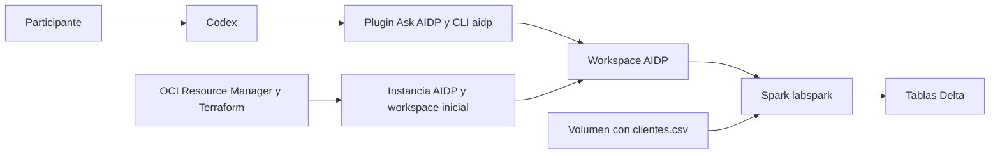
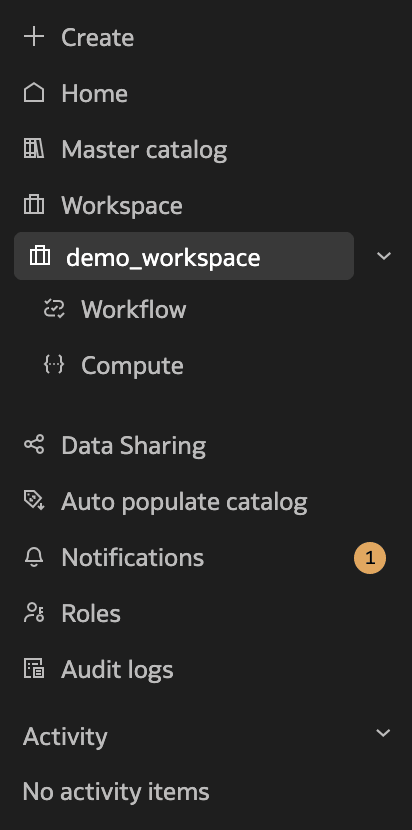
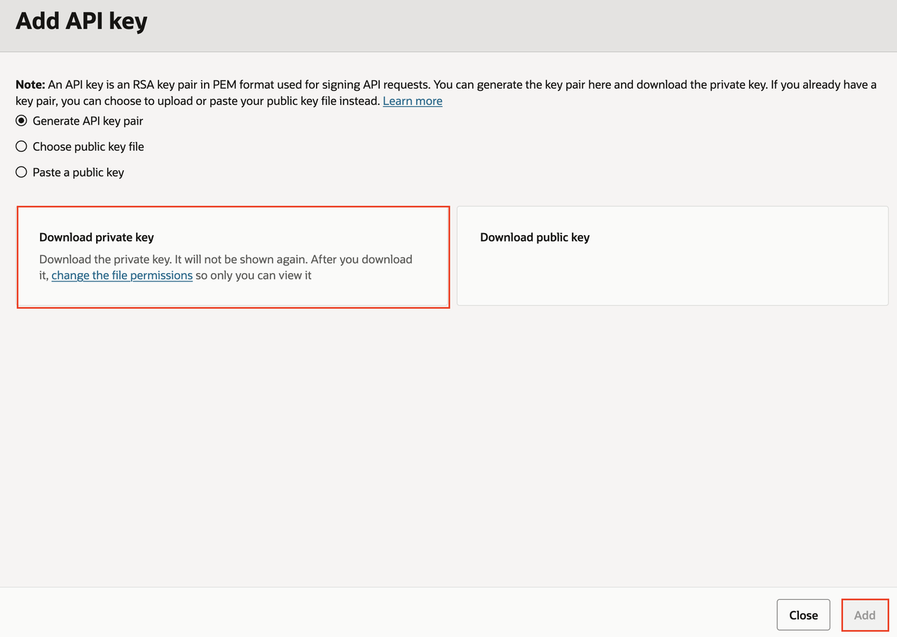
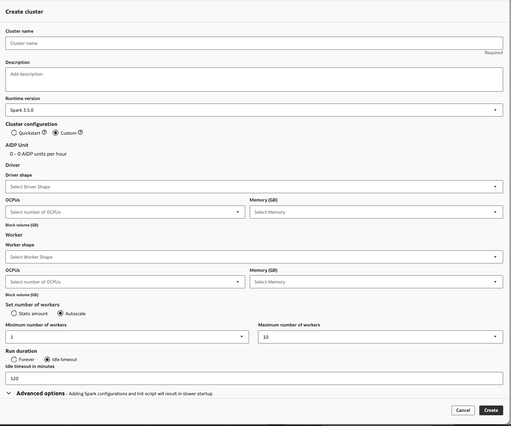
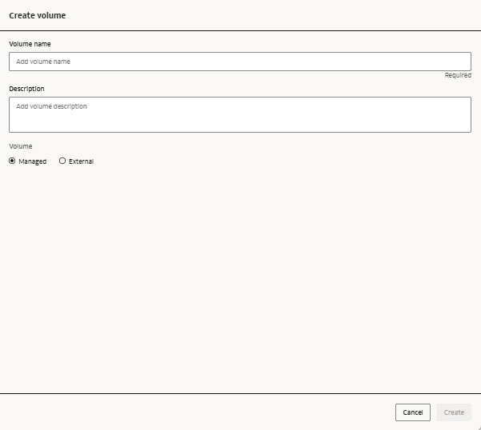
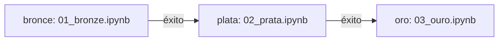
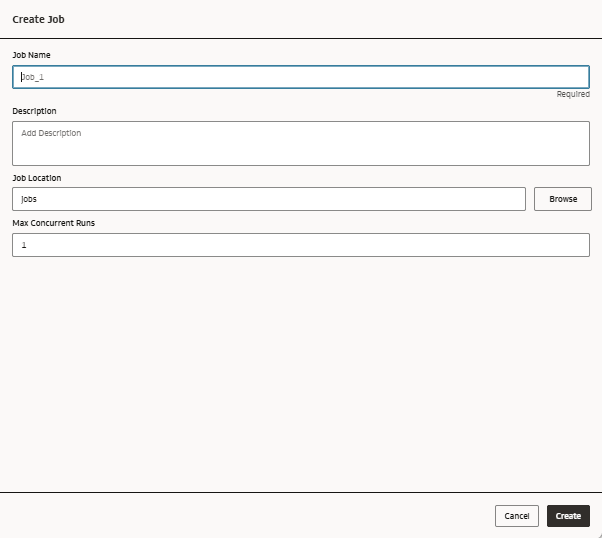
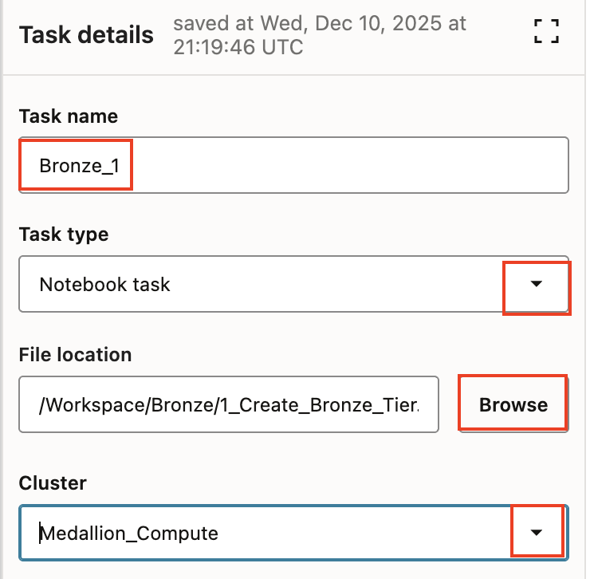
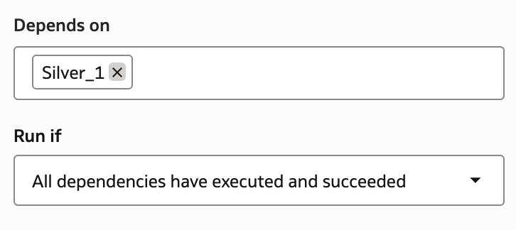
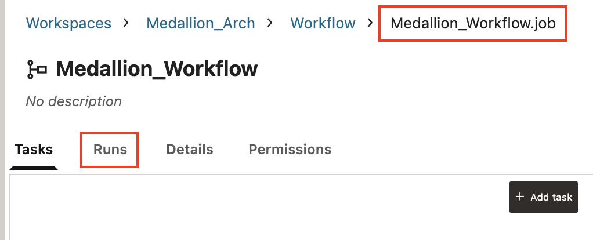

# Taller: Codex + Oracle AI Data Platform

Tutorial para crear un pipeline de datos con capas **bronce, plata y oro** en Oracle AI Data Platform (AIDP), usando Codex y el plugin Ask AIDP. La infraestructura inicial se ejecuta en tu cuenta OCI con Terraform mediante Resource Manager.

Al terminar, tendrás tres notebooks, siete tablas y un job con tareas dependientes. Ejecutarás el mismo job dos veces para verificar que la carga no duplica los resultados.

> **Cómo seguir el taller:** envía un prompt a la vez en el mismo chat de Codex. Espera a que termine, revisa el resultado indicado y después continúa. Los importes de las propuestas son ficticios.

Versión en español para México del [repositorio original de Rafael Dias](https://github.com/rafaelrdias/oracle-ai-exp-codex_aidp), basada en el commit `4c81d4000e1f22acece9d473753c3d54f489cd48`. Los nombres técnicos de recursos, tablas y notebooks se conservan para mantener la correspondencia con el material original: `bronze` = bronce, `prata` = plata y `ouro` = oro. Los encabezados y las categorías del CSV están traducidos; los nombres propios, teléfonos e importes en **BRL (reales brasileños)** se conservan, sin conversión a MXN. Las capturas oficiales se conservan sin cambios y tienen descripciones en español.

## Navegación

1. [Preparación y materiales](#preparacion)
2. [Cuenta OCI e infraestructura con Terraform](#infraestructura)
3. [Computadora, plugin y paquetes Oracle](#computadora)
4. [API Key y conexión al workspace](#conexion)
5. [Spark Compute](#spark)
6. [Ejecución: fuente, bronce, plata y oro](#laboratorio)
7. [Job y nueva ejecución](#job)
8. [Evidencias y cierre](#cierre)
9. [Limpieza del entorno](#limpieza)
10. [Ayuda y referencias](#ayuda)

<a id="preparacion"></a>

## 1. Preparación y materiales

### Antes de la sesión

- Ten acceso a la aplicación con Codex y permiso para instalar Node.js, Git y los componentes Oracle en tu computadora.
- Activa tu propia cuenta OCI según las indicaciones de la organización. Revisa la promoción, el saldo, la vigencia y la disponibilidad de AIDP en **Chicago (`us-chicago-1`)**.
- Usa un usuario autorizado para crear la stack, los compartments, las políticas y la instancia AIDP. Las políticas del paquete autorizan al servicio AIDP y no conceden permisos a tu usuario.
- Prepara los archivos de este repositorio. Para obtenerlos desde GitHub, usa **Code > Download ZIP** y extrae la carpeta localmente.

Resource Manager ejecuta Terraform en OCI. No necesitas instalar Terraform ni Python localmente para seguir el flujo principal. La CLI `aidp` se instalará en la computadora durante la preparación.

### Archivos del taller

| Archivo o carpeta | Uso |
| --- | --- |
| [Terraform.zip](Terraform.zip) | Paquete traducido para cargar en OCI Resource Manager |
| [terraform/](terraform/) | Código de infraestructura y orientación técnica |
| [clientes.csv](clientes.csv) | Fuente ficticia con 100 filas de datos y 11 columnas |
| [ejemplos/ambiente-lab.example.json](ejemplos/ambiente-lab.example.json) | Modelo de configuración local sin datos reales |
| [scripts/verificar-datos.py](scripts/verificar-datos.py) | Verificación local de conteos, reglas e indicadores |

El origen también menciona documentos de resultados esperados, solución de problemas, conversión de 50 diapositivas, publicación en GitHub y fuentes de imágenes, pero esos archivos **no están incluidos en el repositorio original**. Por ello, esta traducción no los enlaza. Las referencias a diapositivas corresponden a la presentación del kit original, que tampoco está incluida.

Las imágenes del tutorial son capturas de la documentación oficial y muestran entornos de ejemplo. Usa los nombres y valores escritos en los pasos.

### Función de cada componente



| Creado por Terraform | Creado después por Codex y Ask AIDP |
| --- | --- |
| Compartment `lab_codex_aidp_rm` | Spark Compute `labspark` |
| Políticas del servicio AIDP | Carpeta, esquema y volumen |
| Instancia `lab-codex-aidp-rm` | Carga del CSV y notebooks |
| Workspace inicial `lab-validacao` | Tablas y job `job_clientes` |
| Lakehouse, si se habilita | Ejecuciones y consultas de resultados |

### Nombres usados en el ejercicio

Cada participante utiliza su propia cuenta. Los mismos nombres pueden usarse en cuentas independientes. Si el facilitador proporciona un entorno compartido, acuerda destinos exclusivos y ajusta los prompts antes de ejecutarlos.

| Objeto | Valor |
| --- | --- |
| Región | `us-chicago-1` |
| Instancia AIDP | `lab-codex-aidp-rm` |
| Workspace | `lab-validacao` |
| Spark Compute | `labspark` |
| Catálogo | `default`, de tipo standard |
| Esquema | `lab_clientes` |
| Volumen administrado (managed) | `entrada` |
| Carpeta remota | `/Workspace/Shared/lab_clientes` |
| CSV en Spark | `/Volumes/default/lab_clientes/entrada/clientes.csv` |
| Job | `job_clientes` |

<a id="infraestructura"></a>

## 2. Cuenta OCI e infraestructura con Terraform

Referencia en la presentación original: diapositivas 7 a 16.

### 2.1 Activa y revisa la cuenta

1. Usa el enlace proporcionado por la organización o el [registro público de Oracle Cloud](https://signup.oraclecloud.com).
2. Completa el registro y la validación del correo electrónico. Revisa la disponibilidad de Chicago antes de definir la región principal (home region).
3. Después de la activación, entra a la consola OCI, revisa la tenancy y selecciona **Chicago (`us-chicago-1`)**.
4. Consulta la vigencia y el saldo de la promoción. Abre **AI Data Platform** y revisa **Limits, Quotas and Usage**.
5. Si falta región, permiso o capacidad, registra el mensaje y consulta al facilitador antes de aprovisionar.

### 2.2 Crea una stack

1. En la consola OCI, abre **Developer Services > Resource Manager > Stacks**.
2. Selecciona un compartment existente, por ejemplo, la raíz de tu cuenta de prueba. La stack debe quedar fuera del compartment temporal que creará Terraform.
3. Haz clic en **Create stack**, selecciona **My configuration** y carga **`Terraform.zip`** de este repositorio.
4. Usa el ZIP interno de Terraform. El ZIP descargado de GitHub contiene todo el tutorial; extráelo antes de localizar `Terraform.zip`.
5. Si aparece **Working directory**, usa la raíz (`.`). Los archivos `.tf` ya están en la raíz del paquete.
6. Selecciona **Terraform 1.5.x** y revisa los siguientes parámetros.

| Parámetro | Valor del taller |
| --- | --- |
| `tenancy_ocid` | Tenancy de tu cuenta, completada por la consola |
| `region` | `us-chicago-1` |
| `lab_name` | `lab-codex-aidp-rm` |
| `workspace_name` | `lab-validacao` |
| `enable_ai_features` | `false`, opción de Lakehouse desmarcada |
| `iam_wait_seconds` | `90`, conserva el valor predeterminado |

El laboratorio usa Spark y no requiere el Lakehouse opcional. Si lo habilitas, el paquete aprovisiona Lakehouse 26ai con 2 ECPUs y 1 TB, lo que consume créditos adicionales. En una stack ya iniciada, conserva la selección y revisa cualquier cambio en el Plan.

El paquete fija Terraform `~> 1.5.0` y el proveedor OCI `9.11.0`. La [documentación de Resource Manager](https://docs.oracle.com/en-us/iaas/Content/ResourceManager/Reference/terraformversions.htm) incluye Terraform 1.5.x. Los requisitos de [estructura del ZIP](https://docs.oracle.com/en-us/iaas/Content/ResourceManager/Concepts/terraformconfigresourcemanager.htm) explican la raíz y la ausencia de archivos de estado en la carga.

### 2.3 Ejecuta Plan y Apply

1. Termina de crear la stack y ejecuta **Plan**.
2. Revisa la región, los nombres y los recursos previstos. Examina las acciones de creación, modificación y eliminación del plan.
3. Después de revisarlo, ejecuta **Apply** y espera a que el job termine correctamente.
4. Si ocurre un error, abre los registros, corrige la configuración y vuelve a intentarlo en **la misma stack**, conservando su estado (state).

> Al retomar un intento, usa la stack existente. Crear otra stack puede generar recursos duplicados y dificultar la limpieza.

### 2.4 Guarda los Outputs y abre Workbench

En los detalles de la stack o del job de Apply, abre **Outputs** y anota localmente:

| Output | Siguiente uso |
| --- | --- |
| `aidp_instance_id` | Identificador de tu instancia para conectar el plugin |
| `region` | Debe corresponder a `us-chicago-1` |
| `workspace_name` | Debe corresponder a `lab-validacao` |
| `console_url` | Enlace para localizar el servicio en la consola |
| `compartment_id` | Identificador del compartment para revisión y limpieza |

Guarda también el nombre y el enlace de la stack. Abre la instancia `lab-codex-aidp-rm`, verifica el estado **ACTIVE** y abre **Workbench**. En **Workspaces**, localiza `lab-validacao` y confirma el catálogo standard `default`.



*Captura de referencia de Oracle. Localiza el workspace `lab-validacao` creado en tu cuenta.*

**Verificación antes de continuar:** Apply completado, instancia activa, workspace accesible y Outputs guardados. El plugin consultará `workspaceKey`. Obtendrás `clusterKey` después de crear Spark.

<a id="computadora"></a>

## 3. Computadora, plugin y paquetes Oracle

Referencia en la presentación original: diapositivas 18 a 23.

### 3.1 Abre el proyecto en Codex

1. Instala la aplicación desde la [descarga oficial](https://chatgpt.com/download). Ábrela, inicia sesión y accede a Codex. Consulta la [guía oficial de la aplicación](https://learn.chatgpt.com/app) si necesitas localizar el acceso.
2. Usa la carpeta extraída de este repositorio como proyecto local o copia su contenido a una carpeta `Lab-Codex-AIDP` en Documentos.
3. Verifica que `clientes.csv` esté en la raíz de esa carpeta.
4. Abre la carpeta como proyecto en Codex e inicia un chat local.

### 3.2 Instala y verifica Node.js y Git

Instala la versión LTS de [Node.js](https://nodejs.org/en/download), con npm, y [Git](https://git-scm.com/downloads), si aún no los tienes. Abre una nueva Terminal en macOS o PowerShell en Windows y ejecuta un comando a la vez:

```shell
node --version
npm --version
git --version
```

Los tres deben mostrar una versión. Si la aplicación estaba abierta durante la instalación, ciérrala por completo y vuelve a abrirla para que encuentre las herramientas.

### 3.3 Agrega el marketplace de Oracle e instala Ask AIDP

En Codex, abre **Plugins** y la opción para agregar un marketplace. Completa:

| Campo | Valor |
| --- | --- |
| Source | `oracle-samples/oracle-aidp-samples` |
| Git ref | `main` |
| Sparse paths, línea 1 | `.agents` |
| Sparse paths, línea 2 | `ai/codex-plugins` |

Agrega el marketplace, localiza **Ask AIDP**, instala y habilita el plugin. Cierra la aplicación por completo, ábrela de nuevo e inicia un nuevo chat en el mismo proyecto.

Si tu versión no muestra ese formulario, envía a Codex esta solicitud:

```text
Instala el plugin Ask AIDP desde el repositorio oficial:
https://github.com/oracle-samples/oracle-aidp-samples/tree/main/ai/codex-plugins/plugins/ask-aidp
Usa el flujo de instalación disponible en esta aplicación.
Al terminar, indica cómo verificar que el plugin esté instalado y habilitado.
```

El [README oficial del plugin](https://github.com/oracle-samples/oracle-aidp-samples/tree/main/ai/codex-plugins/plugins/ask-aidp) describe la instalación y las dependencias. La [documentación de plugins de OpenAI](https://learn.chatgpt.com/plugins) explica la instalación y disponibilidad en las interfaces compatibles.

### 3.4 Descarga los paquetes Oracle

El material de este taller usa la versión **v1.0.0** del SDK/CLI. En la [versión oficial v1.0.0](https://github.com/oracle/aidataplatform-sdk/releases/tag/v1.0.0), descarga:

- `aidp-typescript-client-1.0.0.zip`
- `aidp-npm-cli-1.0.0.zip`

Extrae ambos en Descargas. Dentro de ellos, Codex localizará los paquetes `.tgz`. Instalar el plugin e instalar la CLI `aidp` son pasos separados.

Existen [versiones posteriores](https://github.com/oracle/aidataplatform-sdk/releases). Usa la versión acordada con el facilitador y mantén la CLI y el SDK en la misma versión. Si una operación no existe en la versión instalada, registra la incompatibilidad antes de cambiar versiones.

**Prompt P01 — instalación asistida**

Copia únicamente el siguiente bloque.

```text
Prepara esta computadora para el laboratorio usando Ask AIDP.
Verifica Node.js, npm y la instalación del plugin.
Localiza en Descargas los paquetes .tgz extraídos de la versión Oracle v1.0.0.

Instala aidp-cli, aidp-typescript-client y oci-common en una carpeta
de mi usuario, por ejemplo .aidp/lab-tools/runtime, fuera del proyecto Git.
Localiza la raíz instalada del plugin Ask AIDP que contiene
mcp/ask-aidp-server.mjs. Instala allí, con --no-save,
oci-common y el mismo paquete aidp-typescript-client.

Valida el ejecutable aidp con --help y la resolución de dependencias
en la raíz real del plugin. Indica las versiones y la ruta absoluta del ejecutable.
Esa ruta se guardará como aidpBin en ambiente-lab.json.
Si necesitas una variable de entorno, el plugin lee AIDP_CLI_BIN.
En Windows, considera npm.cmd y aidp.cmd. No instales la CLI de Codex.
No configures credenciales ni crees recursos en la nube en este paso.
Al terminar, muestra el resultado y espera mi siguiente prompt.
```

**Verificación:** el ejecutable `aidp` responde a `--help`, el plugin encuentra `oci-common` y `aidp-typescript-client` y Codex indica la ruta absoluta de la CLI. Tener acceso a la ayuda del plugin por sí solo no demuestra que la CLI esté instalada.

El kit original llama a esta ruta `AIDP_BIN`. En este tutorial queda en el campo **`aidpBin`** de la configuración. La variable de entorno reconocida por el plugin es **`AIDP_CLI_BIN`**.

<a id="conexion"></a>

## 4. API Key y conexión al workspace

Referencia en la presentación original: diapositivas 24 a 26.

### 4.1 Registra una API Key en tu usuario OCI

1. En la consola OCI, abre el perfil del usuario que tendrá acceso al laboratorio.
2. En **API Keys**, selecciona **Add API Key** y genera un par de claves.
3. Descarga la clave privada, termina el registro de la clave pública y copia el fragmento de configuración que muestra OCI.
4. Anota la ruta absoluta del archivo PEM en la computadora.

Pega en el siguiente prompt únicamente el fragmento de configuración y la ruta del archivo. **El contenido de la clave privada permanece en la computadora.** Resource Manager no necesita recibir esa clave.



*Selecciona Generate API key pair y descarga la clave privada antes de completar el registro. La captura solo muestra la interfaz de ejemplo.*

Sigue las [instrucciones de Oracle sobre claves de firma de API](https://docs.oracle.com/en-us/iaas/Content/API/Concepts/apisigningkey.htm). Esta variante usa `api_key`; la contraseña de la consola y una posible contraseña ADMIN de Lakehouse tienen otras funciones.

**Prompt P02 — perfil OCI**

Copia únicamente el siguiente bloque.

```text
Configura la autenticación OCI del laboratorio en mi computadora.
Usa el fragmento generado al registrar mi API Key:
<FRAGMENTO_DE_CONFIGURACION_PROPORCIONADO_POR_OCI>

Clave privada: <RUTA_ABSOLUTA_DEL_ARCHIVO_PEM>.
Crea config-lab-aidp dentro de .oci en la carpeta de mi usuario,
fuera de este repositorio. Usa el perfil [LAB_AIDP] y ajusta key_file.
Usa region=us-chicago-1, según el Output region de la stack.
Conserva los demás perfiles y restringe el acceso a la configuración y la clave.

Usa auth=api_key e indica la ruta absoluta del archivo de configuración.
Verifica que la clave exista sin imprimir su contenido.
No publiques archivos de autenticación en Git.
Al terminar, muestra el resultado y espera mi siguiente prompt.
```

**Verificación:** perfil `[LAB_AIDP]`, región `us-chicago-1`, `key_file` apuntando al PEM existente y acceso restringido. El archivo queda en `~/.oci/config-lab-aidp` en macOS/Linux o `%USERPROFILE%\.oci\config-lab-aidp` en Windows, fuera del repositorio.

### 4.2 Identifica el workspace y guarda la configuración local

Sustituye `<OCID_DE_MI_INSTANCIA>` por el Output `aidp_instance_id` de tu stack. Copia el OCID completo, sin usar el ejemplo de otra persona.

**Prompt P03 — conexión al workspace**

Copia únicamente el siguiente bloque.

```text
Usa Ask AIDP con mi perfil LAB_AIDP en config-lab-aidp
de la carpeta .oci de mi usuario. Localiza la CLI aidp y las dependencias del plugin.
Output aidp_instance_id: <OCID_DE_MI_INSTANCIA>.
Output region: us-chicago-1. Workspace: lab-validacao.

Pasa aidpBin, configFile, profile, auth=api_key, region e instanceId
explícitamente en el parámetro config de las herramientas, sin usar valores
predeterminados de otro entorno. Consulta esta instancia e identifica el workspaceKey real.
Confirma el catálogo standard default. No crees recursos en este paso.

Guarda ambiente-lab.json en la raíz del proyecto con aidpBin, configFile,
profile, auth, region, instanceId y workspaceKey, usando rutas absolutas,
sin contraseñas ni contenido de la clave. clusterKey se completará después.
En las siguientes llamadas, lee este archivo y pasa sus valores en config.
El plugin no carga ambiente-lab.json automáticamente.
Si existe configuración de otro entorno, indica la diferencia antes de modificarla.
Al terminar, muestra el resultado y espera mi siguiente prompt.
```

**Verificación:** la consulta real devuelve la instancia correcta, el `workspaceKey` de `lab-validacao` y el catálogo `default`. Abre el JSON guardado y compara sus identificadores con el entorno de tu cuenta. El [archivo de ejemplo](ejemplos/ambiente-lab.example.json) muestra la estructura con campos ficticios.

El JSON sirve como memoria local para Codex. Debe leerlo y pasar esos valores a las herramientas del plugin. La existencia del JSON no cambia la configuración del plugin. Mantén `auth=api_key` explícito para evitar otro modo de autenticación predeterminado.

<a id="spark"></a>

## 5. Spark Compute

Referencia en la presentación original: diapositiva 27.

Crea o reutiliza un único compute `labspark` en el workspace correcto:

| Configuración | Valor |
| --- | --- |
| Tipo | `USER` |
| Spark | `3.5.0` |
| Shape | AMD compatible, validado en el entorno |
| Driver | 2 OCPUs y 32 GB |
| Workers | 1 worker fijo, 2 OCPUs y 32 GB |
| Autoscaling | Deshabilitado |
| Idle timeout | 15 minutos |



*El ejemplo de Oracle muestra Autoscale de 1 a 10 y un tiempo de espera de 120 minutos. En el taller, selecciona **Static amount = 1**, tiempo de inactividad de **15 minutos** y driver/worker AMD con **2 OCPUs y 32 GB**. Verifica también Spark **3.5.0**. Haz clic en la imagen para ampliarla si lo necesitas.*

**Prompt P04 — Spark**

Copia únicamente el siguiente bloque.

```text
Lee ambiente-lab.json y usa Ask AIDP pasando sus valores en config.
Consulta la ayuda de la CLI instalada.
Busca labspark en el workspace configurado. Créalo solo si no existe.
Si hay nombres duplicados o una configuración diferente, informa y detente.

Configuración: clúster USER, Spark 3.5.0 y shape AMD compatible.
Driver: 2 OCPUs y 32 GB. Un worker fijo: 2 OCPUs y 32 GB.
Sin autoscaling. Idle timeout: 15 minutos. Revisa las opciones compatibles.
Si no están disponibles, detente antes de sustituir versión, shape o capacidad.

Reutiliza el clúster compatible e inícialo si está detenido.
Durante la creación o tras agotar el tiempo de espera, sigue la misma solicitud antes de repetir.
Espera ACTIVE, verifica la configuración y guarda clusterKey en ambiente-lab.json.
Limita este paso al compute. No crees datos, notebooks ni workflows.
Al terminar, muestra el resultado y espera mi siguiente prompt.
```

**Verificación:** compute en **ACTIVE**, configuración confirmada y `clusterKey` guardado en el JSON. Default Master Catalog Compute atiende al catálogo y no sustituye el compute USER de los notebooks.

Si la versión, el shape o la capacidad no están disponibles, registra el impedimento y pide orientación al facilitador. Tras agotar el tiempo de espera, consulta la solicitud o el clúster existente antes de intentar crearlo otra vez. La [API de creación de clústeres](https://docs.oracle.com/en/cloud/paas/ai-data-platform/aiwap/op-aidataplatforms-aidataplatformid-workspaces-workspacekey-clusters-post.html) documenta la operación asíncrona y sus identificadores.

<a id="laboratorio"></a>

## 6. Ejecución del laboratorio

Referencia en la presentación original: diapositivas 29 a 41.

### 6.1 Establece el contexto

Esta primera solicitud solo confirma el entendimiento. Los recursos de datos se crearán en los siguientes pasos.

**Prompt L01 — contexto**

Copia únicamente el siguiente bloque.

```text
Este mensaje solo establece el contexto del laboratorio.
Lee únicamente el archivo local ambiente-lab.json para conocer la configuración.

Workspace: lab-validacao. Spark Compute: labspark.
Catálogo: default. Esquema: lab_clientes.
Carpeta: /Workspace/Shared/lab_clientes.
CSV local: clientes.csv en la carpeta de este proyecto.

En este paso, no crees, modifiques ni ejecutes recursos, notebooks o workflows.
Responde con un resumen del entendimiento y espera mi siguiente prompt.
En los siguientes pasos, ejecuta solo lo solicitado en el mensaje actual.
Al terminar cada paso, presenta los resultados y espera el siguiente.
Conserva los datos de origen y no incluyas credenciales en las respuestas.
```

**Verificación:** respuesta con los nombres y destinos correctos e indicación de que esperará el siguiente paso.

### 6.2 Verifica la conexión y el archivo local

**Prompt L02 — verificación**

Copia únicamente el siguiente bloque.

```text
Lee ambiente-lab.json y verifica la instancia, el workspace y labspark.
Si el compute está detenido, inicia únicamente el clúster configurado.

Ejecuta SELECT 1 AS teste en ese Spark y muestra la salida real.
Si necesitas un notebook, usa solo 00_verificacao.ipynb en
/Workspace/Shared/lab_clientes. Crea la carpeta si hace falta.
Si la herramienta exige un workflow auxiliar, limítalo a esta prueba.

Revisa clientes.csv local e indica el conteo y los 11 nombres de columna.
No crees ni ejecutes los notebooks de bronce, plata y oro en este paso.
Al terminar, muestra el resultado y espera mi siguiente prompt.
```

**Verificación:** la salida de `SELECT 1 AS teste` contiene `teste = 1`. El CSV contiene 100 filas de datos además del encabezado, con 11 campos. El [verificador local](scripts/verificar-datos.py) enumera esos campos y valida los indicadores.

El notebook `00_verificacao.ipynb`, si se necesita, es auxiliar. Los tres notebooks del pipeline comienzan en el paso 6.4.

### 6.3 Crea los destinos y carga el CSV



*Captura de referencia. El prompt crea o reutiliza el volumen managed `entrada` en `default.lab_clientes`. Revisa ese destino en Workbench.*

**Prompt L03 — esquema, volumen y fuente**

Copia únicamente el siguiente bloque.

```text
Crea /Workspace/Shared/lab_clientes y el esquema default.lab_clientes
si todavía no existen. Crea o reutiliza el volumen managed entrada.

Carga clientes.csv local en ese volumen conservando su contenido.
Si el destino ya existe, compara el contenido antes de sustituirlo.
Confirma la carga mediante el listado y la lectura en Spark.

URI esperada: /Volumes/default/lab_clientes/entrada/clientes.csv
Valida 100 filas, 11 columnas y 95 contenidos distintos.
Indica la URI real como URI_CSV. Usa el notebook auxiliar si hace falta.
Limita este paso a los destinos y la fuente. Todavía no crees las tres capas.
Al terminar, muestra el resultado y espera mi siguiente prompt.
```

**Verificación:** el listado del volumen y la lectura con Spark encuentran el mismo archivo. La URI queda en una sola línea:

```text
/Volumes/default/lab_clientes/entrada/clientes.csv
```

Una carpeta de la computadora y una carpeta de Workbench son destinos distintos. Debes cargar el archivo local `clientes.csv` para que Spark pueda acceder a él en ese volumen.

### 6.4 Crea y ejecuta la capa de bronce

La capa de bronce conserva el origen: 100 filas, valores de texto, ceros iniciales y copias idénticas. Los metadatos de carga quedan en columnas adicionales. La deduplicación posterior considera solo los 11 campos de origen.

**Prompt L04 — bronce**

Copia únicamente el siguiente bloque.

```text
Crea 01_bronze.ipynb en /Workspace/Shared/lab_clientes.
Lee /Volumes/default/lab_clientes/entrada/clientes.csv y guarda la tabla Delta
default.lab_clientes.bronze_clientes.

Lee los 11 campos como texto, conservando ceros iniciales,
valores originales, campos vacíos y las 100 filas, incluidos los duplicados.
Usa nombres de columna compatibles con Delta y documenta el mapeo.
Registra la URI de origen en una columna de metadatos.
Calcula un hash SHA-256 de la serialización estructurada de los 11 campos
originales en orden fijo, conservando la distinción entre vacío y nulo.
Configura la lectura CSV para conservar campos vacíos y no inferir tipos.

Ejecuta en el Spark indicado y consulta la tabla persistida.
Las nuevas ejecuciones deben sustituir solo la carga de este ejercicio.
Indica el estado final, los conteos y la ruta del notebook.
Muestra LAB_BRONZE_VALIDADO con los conteos reales.
Usa celdas cortas, comentarios y validaciones. Ejecuta solo esta capa.
Al terminar, muestra el resultado y espera mi siguiente prompt.
```

**Verificación:** `default.lab_clientes.bronze_clientes` tiene 100 filas y 95 contenidos originales distintos. El notebook ejecutado muestra el estado final y el marcador `LAB_BRONZE_VALIDADO` con conteos reales.

### 6.5 Crea y ejecuta la capa de plata

Elimina las copias idénticas según los **11 valores originales antes de normalizar**. Los códigos `018`, `037` y `094` pertenecen a registros distintos en esta fuente: esos seis registros permanecen y reciben una marca de colisión.

| Dato | Regla |
| --- | --- |
| Copias idénticas | Eliminar solo las copias excedentes y registrarlas en la auditoría |
| Código | Conservar como texto, incluidos los vacíos, sin completar ceros automáticamente |
| Estado | Estandarizar mayúsculas/minúsculas y espacios, corregir `Inactvo` y normalizar faltantes |
| Correo electrónico | Ajustar espacios y mayúsculas/minúsculas, conservando el original y la indicación de formato |
| Teléfono | Validar el formato, conservando el original y el criterio utilizado |
| Indicadores numéricos | Convertir controlando valores faltantes y formatos inválidos |
| Resultado a 30 días | `Sí` = verdadero, `No` = falso, `No aplica` = nulo |

**Prompt L05 — plata**

Copia únicamente el siguiente bloque.

```text
Crea y ejecuta 02_prata.ipynb en /Workspace/Shared/lab_clientes,
a partir de bronce, en el esquema default.lab_clientes.
Guarda prata_clientes; conserva registros inválidos y originales para auditoría.
Elimina solo copias idénticas en los 11 campos originales antes de estandarizar.
Registra grupos duplicados en prata_auditoria_duplicatas con
quantidade_excedente = quantidade_original - 1. La suma esperada es 5.
Conserva los códigos como texto y los vacíos, sin completar ceros automáticamente.
Guarda las colisiones en prata_colisoes_codigo sin eliminar esos registros.

Ajusta espacios y correos en minúsculas; valida formatos de correo y teléfono.
Convierte indicadores numéricos; distingue faltantes de formatos inválidos.
Estado: Activo/ACTIVO/activo con espacios → Activo; Inactvo → Inactivo.
En negociacion → En negociación; vacío/N/A → No informado.
Resultado: Sí → verdadero; No → falso; No aplica → nulo.
Considera colisión solo para códigos no vacíos. Conserva los seis
registros con código vacío sin tratarlos como otro código en colisión.
Las nuevas ejecuciones deben sustituir solo las tablas de este ejercicio,
incluidas auditoría y colisiones, sin append ni afectar otros destinos.
Verifica las tablas: 95 registros y 6 con colisión en 3 códigos.
Usa celdas cortas, comentarios y validaciones. Ejecuta solo esta capa.
Al terminar, muestra el resultado y espera mi siguiente prompt.
```

**Verificación:** `prata_clientes` tiene 95 registros. La suma de `quantidade_excedente` en `prata_auditoria_duplicatas` es 5. `prata_colisoes_codigo` conserva los seis registros de los tres códigos en colisión. Bronce permanece con 100 filas.

### 6.6 Crea y ejecuta la capa de oro

La capa de oro responde las preguntas del ejercicio con tres tablas: `ouro_resumo`, `ouro_por_status` y `ouro_por_empresa`.

**Prompt L06 — oro**

Copia únicamente el siguiente bloque.

```text
Crea y ejecuta 03_ouro.ipynb en /Workspace/Shared/lab_clientes
usando default.lab_clientes.prata_clientes.
Guarda ouro_resumo, ouro_por_status y ouro_por_empresa
en el esquema default.lab_clientes.

Calcula el total de registros, conversiones, no conversiones
y casos con resultado No aplica.
Calcula la conversión como Sí / (Sí + No).
Excluye No aplica solo de ese denominador y maneja la división entre cero.

Incluye el importe total de propuestas con tipo decimal, identificado como ficticio y en BRL.
Mantén las empresas faltantes en un grupo propio.
Las nuevas ejecuciones deben sustituir solo las tablas de oro de este ejercicio,
sin append ni afectar otros destinos.
Compara los totales de las agregaciones con la capa de plata.
Indica el estado final y los resultados reales de las tablas guardadas.
Usa celdas cortas, comentarios y validaciones. Ejecuta solo esta capa.
Al terminar, muestra el resultado y espera mi siguiente prompt.
```

**Verificación:**

| Indicador | Referencia |
| --- | ---: |
| Registros en plata | 95 |
| Resultado Sí | 27 |
| Resultado No | 30 |
| Resultado No aplica | 38 |
| Casos aplicables | 57 |
| Conversión a 30 días | **47.37%** |
| Importe total ficticio de propuestas | BRL 3,132,500.00 |

```text
Conversión = Sí / (Sí + No) × 100
           = 27 / (27 + 30) × 100
           = 47.37%
```

Los 38 casos “No aplica” permanecen en la base y solo quedan fuera del denominador de conversión. El estado actual y el resultado a 30 días son campos distintos.

### 6.7 Haz preguntas con consultas reales

**Prompt L07 — preguntas sobre los datos**

Copia únicamente el siguiente bloque.

```text
Consulta las tablas de oro de este participante y responde:

1. ¿Cuántos registros están activos, inactivos, en negociación
   o con estado no informado?
2. ¿Cuál es la conversión a 30 días? Muestra numerador y denominador.
3. ¿Qué empresa concentra el mayor importe de propuestas?
   Señala que los importes comerciales son ficticios y están en BRL.

Ejecuta las consultas en AIDP.
Muestra la tabla consultada, los criterios y los resultados devueltos.
Distingue el estado actual del resultado de conversión a 30 días.
Al terminar, muestra el resultado y espera mi siguiente prompt.
```

Compara la respuesta con esta referencia calculada sobre el CSV:

| Estado actual | Registros |
| --- | ---: |
| Activo | 38 |
| Inactivo | 24 |
| En negociación | 20 |
| No informado | 13 |
| **Total** | **95** |

La empresa **Sol Nascente** concentra el mayor importe ficticio de propuestas: **BRL 362,000.00**, en nueve registros. La respuesta de Codex debe incluir la consulta y la salida real de tu AIDP para compararla con esta referencia.

<a id="job"></a>

## 7. Job y nueva ejecución

Referencia en la presentación original: diapositivas 42 a 45.

### 7.1 Configura dependencias y ejecuta una vez





*Captura de referencia de la creación de un job. En el ejercicio, usa `job_clientes` y selecciona `labspark` en las tareas.*

**Prompt L08 — job con dependencias**

Copia únicamente el siguiente bloque.

```text
Crea o reutiliza el job job_clientes en este workspace.
Si hay un único job compatible, reutilízalo.
Si hay nombres duplicados o una configuración diferente, informa y detente.
Configura tres tareas: bronze, prata y ouro.

La tarea bronze ejecuta 01_bronze.ipynb.
prata ejecuta 02_prata.ipynb solo después de que bronze termine correctamente.
ouro ejecuta 03_ouro.ipynb solo después de que prata termine correctamente.
Usa el Spark Compute indicado y los mismos destinos de los notebooks.

Ejecuta el job una vez.
Espera al estado final y consulta la salida de cada tarea.
Indica las dependencias, el resultado y la duración.
No crees una programación recurrente.
Al terminar, muestra el resultado y espera mi siguiente prompt.
```

Revisa los detalles de cada tarea en la interfaz:



*En el ejemplo aparecen `Bronze_1` y `Medallion_Compute`. En este taller, la tarea `bronze` usa `/Workspace/Shared/lab_clientes/01_bronze.ipynb` y el compute `labspark`. Configura `prata` y `ouro` con sus respectivos notebooks.*



*La captura usa `Silver_1` como ejemplo. En este taller, `prata` depende de `bronze` y `ouro` depende de `prata`, con la condición de que todas las dependencias hayan terminado correctamente.*

**Verificación:** tres tareas, cada una apuntando al notebook correcto, con plata dependiente de bronce y oro dependiente de plata. Espera a que todas las tareas terminen correctamente y registra el job ID, run ID y la duración.

### 7.2 Vuelve a ejecutar el mismo job

**Prompt L09 — nueva ejecución**

Copia únicamente el siguiente bloque.

```text
Vuelve a ejecutar el mismo job una vez, sin crear otro.
Espera al estado final de las tres tareas.

Revisa de nuevo los conteos de bronce, plata y auditoría,
los códigos en colisión y los indicadores de oro.

Compara con la primera ejecución.
Confirma que los totales no se duplicaron y que los destinos permanecen
en la carpeta y el esquema exclusivos de este participante.

Indica cualquier diferencia y la duración de la segunda ejecución.
Al terminar, muestra el resultado y espera mi siguiente prompt.
```

**Verificación:** las dos ejecuciones tienen run IDs distintos y pertenecen al mismo job. Los conteos permanecen en 100 para bronce, 95 para plata y 5 copias excedentes en la auditoría. La conversión y las agregaciones permanecen iguales.

Este resultado verifica la estabilidad de la carga para el mismo archivo. Si los totales se duplican, revisa el modo de escritura y los destinos antes de continuar.

### 7.3 Revisa también los resultados en la interfaz

En Workbench:

1. Abre **Workspaces > lab-validacao** y localiza **Shared > lab_clientes**.
2. Abre los tres notebooks y revisa la salida de las celdas y el compute utilizado.
3. En **Workflows**, abre `job_clientes`, la pestaña **Runs** y los detalles de las tareas de cada ejecución.
4. En **Master catalog > default > lab_clientes**, revisa las tablas y sus consultas.



*La captura muestra `Medallion_Workflow`. Abre `job_clientes` en tu workspace y usa la pestaña Runs para revisar ambos run IDs.*

Si quieres repetir las verificaciones explícitamente, ejecuta estas consultas en el Spark del ejercicio mediante AIDP y compara la salida real:

```sql
SELECT 'bronce' AS capa, COUNT(*) AS registros
FROM default.lab_clientes.bronze_clientes
UNION ALL
SELECT 'plata' AS capa, COUNT(*) AS registros
FROM default.lab_clientes.prata_clientes;

SELECT SUM(quantidade_excedente) AS copias_excedentes
FROM default.lab_clientes.prata_auditoria_duplicatas;

SELECT * FROM default.lab_clientes.ouro_resumo;
SELECT * FROM default.lab_clientes.ouro_por_status;
SELECT * FROM default.lab_clientes.ouro_por_empresa;
```

<a id="cierre"></a>

## 8. Evidencias y cierre

Referencia en la presentación original: diapositivas 47 y 48.

Antes de eliminar recursos, consolida los resultados y exporta los notebooks.

**Prompt E01 — exportación y detención de Spark**

Copia únicamente el siguiente bloque.

```text
Consolida los resultados reales de las dos ejecuciones de job_clientes.
Enumera notebooks, tablas, job ID, run IDs y estados de las tareas.

Confirma bronce con 100 filas y plata con 95 registros.
Muestra cinco copias excedentes, tres códigos en colisión
con seis registros conservados y conversión 27 / 57 = 47.37%.

Guarda el resumen en evidencias/ y exporta los notebooks a
notebooks-exportados/ en la carpeta local del proyecto.
Confirma que los archivos exportados pueden abrirse.
Después, detén solo el compute labspark de esta cuenta.
La limpieza mediante Terraform será en el siguiente paso. No ejecutes Destroy ahora.
Al terminar, muestra el resultado y espera mi siguiente prompt.
```

### Lista de verificación de cierre

- [ ] `01_bronze.ipynb`, `02_prata.ipynb` y `03_ouro.ipynb` exportados y abriendo correctamente.
- [ ] Siete tablas presentes: bronce, plata, auditoría, colisiones y tres tablas de oro.
- [ ] Un `job_clientes` con tres tareas dependientes y dos ejecuciones completas.
- [ ] Job ID, run IDs, estados y duraciones guardados localmente.
- [ ] Conteos verificados: 100, 95, cinco copias excedentes y seis registros en colisión.
- [ ] Conversión de 27/57 = 47.37% confirmada mediante consulta real.
- [ ] Compute `labspark` detenido después de completar las ejecuciones.

Para documentar tu taller, captura la pantalla de Outputs de la stack, la configuración de Spark, la salida de los notebooks y los detalles de las dos ejecuciones. Al compartir evidencias, elimina credenciales e identificadores personales. Las carpetas `evidencias/` y `notebooks-exportados/` quedan fuera de Git de forma predeterminada.

<a id="limpieza"></a>

## 9. Limpieza del entorno

Referencia en la presentación original: diapositiva 49.

Este paso elimina el entorno del laboratorio. Hazlo después de guardar los resultados que quieras conservar.

1. Confirma que no haya tareas en ejecución, que `labspark` esté detenido y que los notebooks y evidencias estén exportados.
2. Revisa en AIDP los datos administrados y los recursos internos del ejercicio, incluidas las opciones de eliminación de archivos y datos.
3. En Resource Manager, abre **la misma stack** utilizada para el aprovisionamiento.
4. Abre **Terraform actions > Destroy**, revisa el impacto y ejecuta la eliminación.
5. Sigue el job y revisa los recursos en el compartment del laboratorio. El state no enumera individualmente todos los objetos creados por el plugin o por el propio servicio.
6. Si no se puede eliminar el compartment por recursos residuales, revisa solo buckets y registros del laboratorio, sigue las indicaciones del facilitador para eliminarlos y repite Destroy en la misma stack.
7. Elimina la stack solo después de terminar la limpieza. Revisa los recursos y costos restantes en la consola.

Detener Spark reduce el consumo del compute, pero otros recursos pueden seguir consumiendo créditos. Eliminar la stack sin ejecutar Destroy no elimina la infraestructura. Esta variante mantiene el state en Resource Manager; usa ese flujo de limpieza.

<a id="ayuda"></a>

## 10. Ayuda y referencias

- **¿Algo falló?** Guarda el mensaje, el paso y el ID de la solicitud o ejecución antes de repetir. Consulta al facilitador; el documento de solución de problemas mencionado en el origen no está incluido.
- **¿Quieres revisar las reglas?** Consulta los pasos 6.4 a 6.7 y ejecuta el verificador local. Los números de referencia se calculan sobre el CSV para compararlos con tu ejecución en AIDP.
- **¿Quieres retomar en otro chat?** Abre el mismo proyecto y envía:

```text
Lee únicamente ambiente-lab.json y confirma el entorno configurado.
Estoy retomando el taller en el paso <PASO_ACTUAL>.
Cuando envíe el siguiente prompt, usa Ask AIDP con los valores del JSON
pasados explícitamente en config. Conserva los recursos existentes.
Por ahora, solo confirma el entendimiento y espera.
```

- **¿Quieres validar el CSV localmente?** Si ya tienes Python 3, ejecuta opcionalmente:

```shell
python3 scripts/verificar-datos.py
```

- **¿Quieres publicar el tutorial?** Este repositorio en español está preparado como proyecto Git independiente en [mxai-tech/oracle-ai-exp-mx-codex_aidp](https://github.com/mxai-tech/oracle-ai-exp-mx-codex_aidp).
- **¿Quieres localizar la diapositiva de origen?** Solicita al facilitador la presentación original; no está incluida en este repositorio.

### Fuentes y versiones

Tutorial original adaptado de `Apresentacao.pptx`, `Prompts.txt`, `Leia-me.txt`, `clientes.csv` y `Terraform.zip` del kit del taller. La presentación original identifica Oracle AI Experience Brasil y Copyright © 2026, Oracle and/or its affiliates.

Revisión documental del origen: **4 de noviembre de 2026**. Traducción al español: **18 de noviembre de 2026**. Se conservan las versiones del kit: SDK/CLI Oracle v1.0.0, Terraform 1.5.x, proveedor OCI 9.11.0 y Spark 3.5.0. El marketplace usa `main`, que puede actualizarse; registra la versión del plugin utilizada en el evento.

El origen declara la revisión de archivos, referencias oficiales y resultados del CSV. La traducción incluye verificación local del CSV y del paquete, sin una ejecución completa de Plan/Apply, notebooks o Destroy en OCI. Confirma las cuotas, los permisos, la capacidad regional y la compatibilidad de herramientas en el entorno del taller.

- [Repositorio original y capturas de referencia](https://github.com/rafaelrdias/oracle-ai-exp-codex_aidp)
- [Oracle: Ask AIDP](https://github.com/oracle-samples/oracle-aidp-samples/tree/main/ai/codex-plugins/plugins/ask-aidp)
- [Oracle: SDK y CLI](https://github.com/oracle/aidataplatform-sdk)
- [Oracle: versión v1.0.0](https://github.com/oracle/aidataplatform-sdk/releases/tag/v1.0.0)
- [Oracle: Resource Manager y estructura de Terraform](https://docs.oracle.com/en-us/iaas/Content/ResourceManager/Concepts/terraformconfigresourcemanager.htm)
- [Oracle: claves de firma de API](https://docs.oracle.com/en-us/iaas/Content/API/Concepts/apisigningkey.htm)
- [OpenAI: aplicación](https://learn.chatgpt.com/app)
- [OpenAI: plugins](https://learn.chatgpt.com/plugins)
